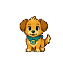
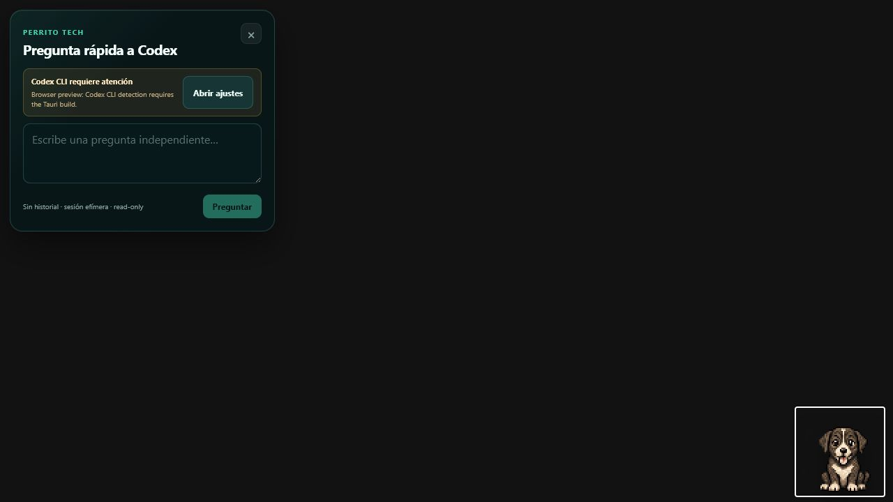
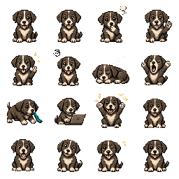
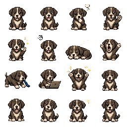
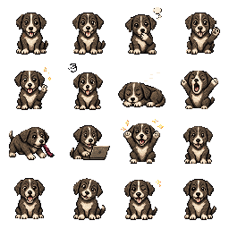
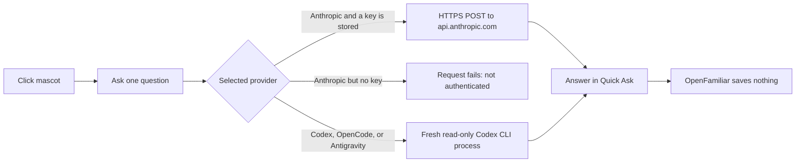

<p align="center">
  
</p>

<h1 align="center">OpenFamiliar</h1>

<p align="center"><strong>Ask once. Get an answer. It forgets.<br>
A pixel-art desktop buddy for your Codex CLI.</strong></p>

<p align="center">No history, no OpenFamiliar account, no telemetry.</p>

<p align="center">Windows 11 x64 only for now. The public beta installer is unsigned;
<a href="#unsigned-installer-heres-how-to-verify">here's how to verify</a>.</p>

<p align="center">
  <a href="https://github.com/p3rformative/openfamiliar/actions/workflows/ci.yml"></a>
  <a href="https://github.com/p3rformative/openfamiliar/releases"></a>
  <a href="https://github.com/p3rformative/openfamiliar/releases"></a>
  
  
  
</p>

> OpenFamiliar is an independent open-source project and is not affiliated with,
> sponsored by, or endorsed by OpenAI, Google, xAI, Anthropic, Microsoft, Amazon,
> or their respective products.

<!-- TODO: replace this placeholder with a real 5-8 s hero GIF: 480 px wide, under 3 MB, captured from the actual Windows desktop app. Do not use a simulated or generated recording. -->

<p align="center">
  
  <br>
  
  
  
  <br>
  <sub>Teal (default), midnight, and burgundy accent palettes. He stays put until you ask—no pacing, no side-eye.</sub>
</p>

## Why

- Ask one independent question, get an answer, and the interaction is discarded. OpenFamiliar does not keep a conversation history.
- A transparent, always-on-top pixel-art companion. Idle stays visually static; animation runs only for explicit events.
- Quick Ask answers through the Codex CLI you already installed and signed in, or through Anthropic if you select it in Settings and a key is stored. If you select Anthropic without a key, the request fails as not authenticated and does not fall back to Codex CLI. OpenFamiliar does not read Codex auth storage.

**Built for:** people who already use Codex CLI and want a quiet desktop way to
ask one question; operators who want a local-first companion with no
OpenFamiliar account, cloud backend, or telemetry; and contributors who build
or validate familiar packs with `mascot-sdk`.

## Download and quick start

1. Download the official `v0.1.0` public beta only from [GitHub Releases](https://github.com/p3rformative/openfamiliar/releases/tag/v0.1.0). Do not download OpenFamiliar binaries from third-party sites.
2. Verify the unsigned installer (checksum and attestation below), then install.
3. Start OpenFamiliar, click Perrito Tech, and ask one question. A real answer requires either Codex CLI installed and authenticated on the same machine, or Anthropic selected in Settings with a key stored in the OS keychain.

<p id="unsigned-installer-heres-how-to-verify"></p>

<details>
<summary>Unsigned installer, here's how to verify</summary>

The `v0.1.0` public beta is unsigned, so Windows may display a SmartScreen warning.
Download `SHA256SUMS.txt` from the [v0.1.0 Releases page](https://github.com/p3rformative/openfamiliar/releases/tag/v0.1.0),
where it is published as a release asset next to the installers
([direct download](https://github.com/p3rformative/openfamiliar/releases/download/v0.1.0/SHA256SUMS.txt)).
The packaging workflow attests the NSIS `.exe` and `.msi`; it does not attest
`SHA256SUMS.txt`. Verify a
downloaded NSIS installer with:

```powershell
Get-FileHash .\OpenFamiliar_*.exe -Algorithm SHA256
gh attestation verify .\OpenFamiliar_*.exe --repo p3rformative/openfamiliar
```

Unsigned does not mean unverified: compare the SHA-256 value with the release
checksum and install only when both the repository and artifact are trusted.

</details>

## How it works

You click the mascot, type one question, and the answer appears in Quick Ask.
If Codex CLI is selected, OpenFamiliar starts a fresh read-only Codex CLI
process; the prompt and answer stay in memory only for that request, and the
process then exits. OpenFamiliar does not save the question or the answer.
When the answer goes through Codex CLI, Codex CLI sends your question to its
provider under its own terms; OpenFamiliar does not control what they retain.
Optional provider keys, if you add one in Settings, are stored in the OS
keychain, never in `preferences.json` or logs. Newer builds than v0.1.0 can
also answer through Anthropic if you select it and a key is stored.



## Status

<details>
<summary>Public beta v0.1.0 and roadmap</summary>

The Windows 11 x64 desktop, Perrito Tech sprites (CC BY 4.0), static idle with
event-only animation, teal/midnight/burgundy accents, Settings, tray,
click-through recovery, preferences, monitor-safe position, timeout/cancel, OS
keychain for optional provider secrets, and unsigned MSI/NSIS installers are
implemented and tested as described in [ROADMAP.md](./ROADMAP.md). Quick Ask
answers through Codex CLI by default, with fake-CLI tests. A clean-user smoke test has
passed on a separate Windows computer.

OpenCode and Antigravity are planned. The v0.1.0 installer answers only through
Codex CLI; newer builds can also answer through Anthropic if you select it in
Settings. Other modules in the repo are experimental.

</details>

## Security and privacy

- No generic shell command or user-supplied CLI arguments.
- When answering through Codex CLI: fresh ephemeral, read-only process per question.
- Prompt input and output size limits, and timeout. When answering through Codex CLI: cancellation and process-tree kill.
- Restrictive Tauri CSP and minimum capability allowlist.
- No auth/session scraping, `.env` runtime loading, loopback listener, MCP, or remote UI.
- No prompt, answer, credential, token, or raw process output in logs.

See the [privacy policy](./PRIVACY.md), [ADR-009](./docs/adr/ADR-009-windows-one-shot-mvp.md),
and the [security boundary playbook](./docs/agent-playbooks/security-boundaries.md).

## Contributing

Setup, validation, installer builds, and the
[repository layout](./CONTRIBUTING.md#repository-layout) are in
[CONTRIBUTING.md](./CONTRIBUTING.md).
Pack types live in [`packages/mascot-sdk`](./packages/mascot-sdk).
Perrito Tech artwork is credited as “Perrito Tech — OpenFamiliar contributors”
(CC BY 4.0); see the [asset notice](./mascots/perrito-tech/NOTICE).

Questions and patches go through [Issues](https://github.com/p3rformative/openfamiliar/issues)
and pull requests. Look for issues labeled
[good first issue](https://github.com/p3rformative/openfamiliar/issues?q=is%3Aissue+is%3Aopen+label%3A%22good+first+issue%22)
if you want a starter task.

## License

- Code: [Apache License 2.0](./LICENSE)
- Perrito Tech artwork: CC BY 4.0
- Blank templates: CC0-1.0

See [NOTICE](./NOTICE), [THIRD_PARTY_NOTICES.md](./THIRD_PARTY_NOTICES.md), and
the Perrito Tech [asset notice](./mascots/perrito-tech/NOTICE).
