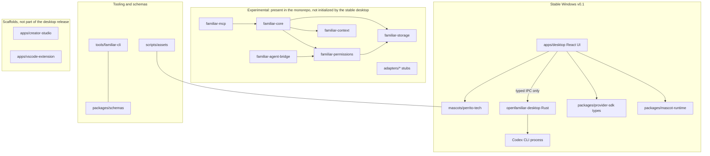

# Architecture overview

Stable v0.1 is the Windows desktop app in `apps/desktop/`. It talks to a narrow
Rust IPC surface in `apps/desktop/src-tauri/` and runs one ephemeral Codex CLI
process at a time. Shared crates under `crates/` implement future core services
and are **not** started by that desktop process. See
[ADR-009](../adr/ADR-009-windows-one-shot-mvp.md).

The module and crate map is in [modules.md](./modules.md). Decisions live in
[docs/adr/](../adr/README.md).

